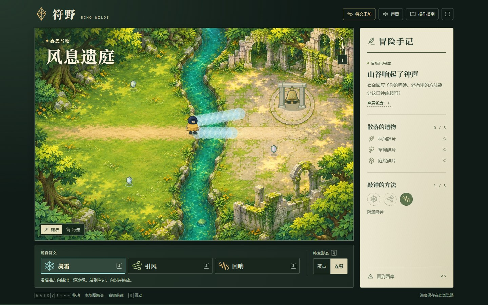

# 符野 · 风息遗庭

[在线试玩](https://ayasecastorice-maker.github.io/echo-wilds/) · [下载单文件游戏 v1.0.0](https://github.com/ayasecastorice-maker/echo-wilds/releases/download/v1.0.0/echo-wilds.html) · [下载源码 ZIP v1.0.0](https://github.com/ayasecastorice-maker/echo-wilds/releases/download/v1.0.0/echo-wilds-source.zip)

一款可以直接打开的小型浏览器探索解谜游戏。你来到溪流西岸，要让东岸的旧钟再次响起。带上三种符文，在同一片遗庭里尝试不同走法，也可以寻找三件散落的遗物。

完整保留项目文件夹，双击 **`index.html`** 即可开始；也可以把它拖进现代浏览器。无需安装依赖、构建或联网。目标完成后仍能继续探索，「冒险手记」会记录已发现的三种解法。

## 怎么玩

| 操作 | 键盘与鼠标 | 触控 |
| --- | --- | --- |
| 行走 | `WASD` / 方向键；右键点击地面 | 选地图左下「行走」，再点目标 |
| 施法 | 鼠标瞄准后左键点击；也可按空格 | 选「施法」，再点目标 |
| 选择符文 | `1` 凝霜、`2` 引风、`3` 回响 | 点下方符文按钮 |
| 切换形态 | `Q` 切换「聚点 / 连缀」 | 点对应形态按钮 |
| 互动 | 靠近旧钟或遗物，按 `E` | 点出现的互动按钮 |
| 查看操作 | `H` 或「操作指南」 | 点「操作指南」 |

选择符文或点击形态按钮后，地图会切到「施法」。触控设备初始使用「行走」。想移动时记得切回来；靠近遗物也会自动拾取。

三种符文各有两种形态，可以自由切换、连续搭配使用。施法会受距离、落脚点和短暂冷却限制；下方文字会说明当前形态的作用。没有固定施法顺序，可以先试，再看手记里的可选线索。

顶部「声音」可以静音。声音在首次点击或按键后启动；打开操作指南时，游戏模拟会暂停。

## 自己编一张配方

打开顶部「符文工坊」，给第一术、第二术分别选择符文与形态，再选择短（0.85 秒）或长（1.30 秒）间隔。配方可以取名；点「装配配方」后，一次瞄准施法就会依次执行两术。

第二术始终瞄准第一次选定的地图位置，从角色当时所在的位置发出；仍须满足各自的冷却、射程与落脚点规则。选回普通符文或切换形态即可解除配方；回到西岸、重新开始或再次打开工坊会取消尚未发出的第二术。

工坊内可复制短码、粘贴导入，例如 `EW1-霜连-响聚-短`。短码只包含两术和间隔，不包含名称或探索记录，不访问网络。当前配方单独保存在本机；重开页面后，可以到工坊重新装配。打开工坊时游戏暂停。

卡住了？展开查看三种解法

先走到西岸小路靠近溪水的一端，再尝试以下方法：

1. **踏冰过溪**：选「凝霜 · 连缀」，朝东岸空地铺出冰径；切回行走，在冰融化前过去，靠近旧钟互动。也可以用「聚点」逐块铺冰。
2. **乘风越岸**：选「引风 · 连缀」，瞄准射程内的东岸空地跃过去，再走近旧钟互动。风跃需要有效落脚点。
3. **隔溪鸣钟**：留在西岸，选「回响 · 聚点」，对准东岸的钟发射音波。

完成一种后，点「回到西岸」就能保留记录、继续试另一种。踏冰和风跃的印记在过河后触碰旧钟时记录；隔溪回响直接命中旧钟即可记录。

还想试试符文之间的组合？

- 凝霜制造的冰面既能行走，也能作为引风的落脚点。
- 回响穿过水面上的冰会产生共鸣，让这一束音波继续向前传播得更远。
- 「引风 · 连缀」留下短暂风道，顺着风道行走会更快。
- 「回响 · 连缀」发出散开的音波，可以让附近尚未收集的遗物短暂显现；发现后仍要靠近拾取。

这些组合可以用于探索，不是完成目标的必选步骤。冰面消融后若失去落脚点，角色会回到最近踏实的岸边，已收集的记录保留。

## 存档与重新开始

进度会自动存入当前浏览器的 `localStorage`，包括位置、符文选择、遗物和已发现的解法；声音偏好单独保存。数据留在本机，不上传服务器。换浏览器、移动文件夹或清理浏览器数据后，原记录可能不可用；浏览器禁止本地存储时，页面会显示提示，仍可继续本次游玩。

- **回到西岸**：回到起点，保留遗物与解法记录。
- **从头开始**：打开「操作指南」，点击「清除本机存档」，在 5 秒内再点一次确认。探索进度重置，声音偏好与保存的配方保留。

## 素材与扩展

地图由 OpenAI imagegen 原创生成，并按实际河岸标定了游戏区域。角色、旧钟、遗物、图标和魔法效果用 Canvas 2D 程序绘制；钟声、符文声和拾取音由 Web Audio 实时合成。项目没有附带第三方游戏角色素材或音乐录音。

| 文件 | 内容与可扩展位置 |
| --- | --- |
| `index.html`、`style.css` | 页面、手记、操作按钮与响应式布局 |
| `app.js` | 输入、触控、界面更新、自动存档与重置 |
| `core.js` | 移动、寻路、碰撞、符文规则、组合效果与完成记录 |
| `recipes.js` | 双术式配方、延时衔接、短码分享与独立配方存档 |
| `terrain.js` | 1200 × 800 世界坐标、河岸、陆地可走区、障碍与交互点 |
| `renderer.js` | 人物、场景动态、魔法、目标指示与绘制顺序 |
| `ink.js`、`sound.js` | 程序图标与合成音效 |
| `assets/terrain.webp` | 无人物、旧钟和桥的静态地图底图 |
| `tools/pack.py` | 打包为单文件网页与源码压缩包 |

更换地图时，应同步校准 `terrain.js` 的河岸与可走区；新增符文时，需要同时接上核心规则、渲染、音效和按钮文案。改动存档结构时，同步维护 `serialize / restore` 与版本号。

如需重新打包，在项目目录运行 `python tools/pack.py`，生成 `dist/echo-wilds.html` 和源码包 `dist/echo-wilds-source.zip`；直接游玩无需 Python。

## 许可证

本项目采用 [MIT License](LICENSE)。Copyright (c) 2026 ayasecastorice-maker。复制、修改或分发时，请保留许可证与版权声明；单文件游戏也已内嵌完整许可注释。
